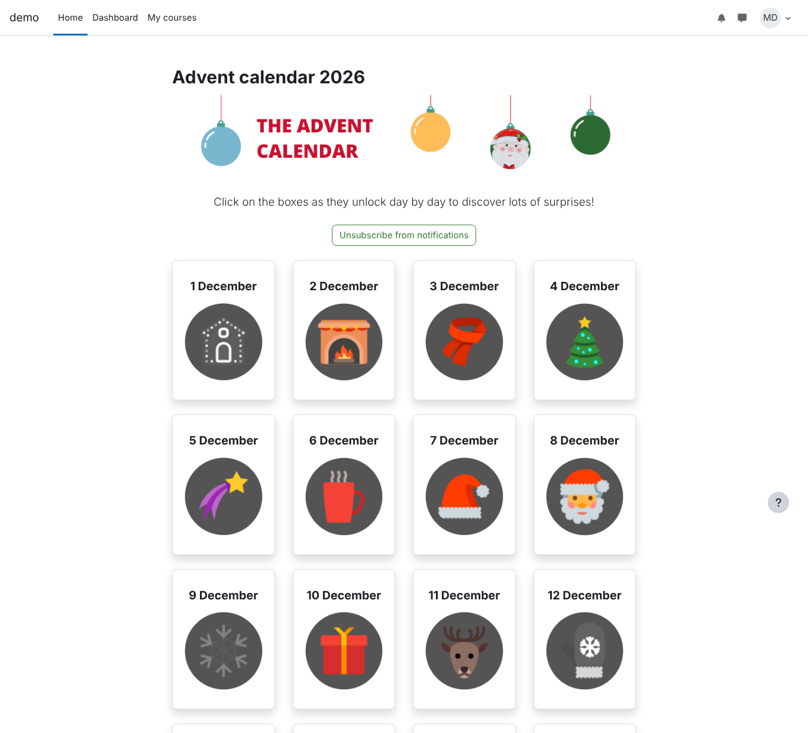
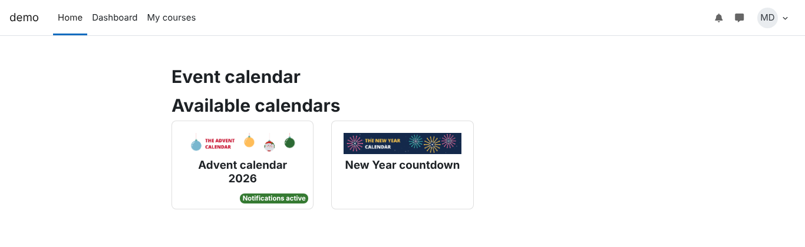
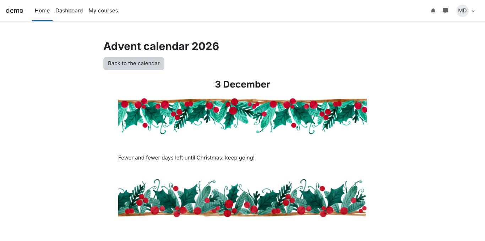
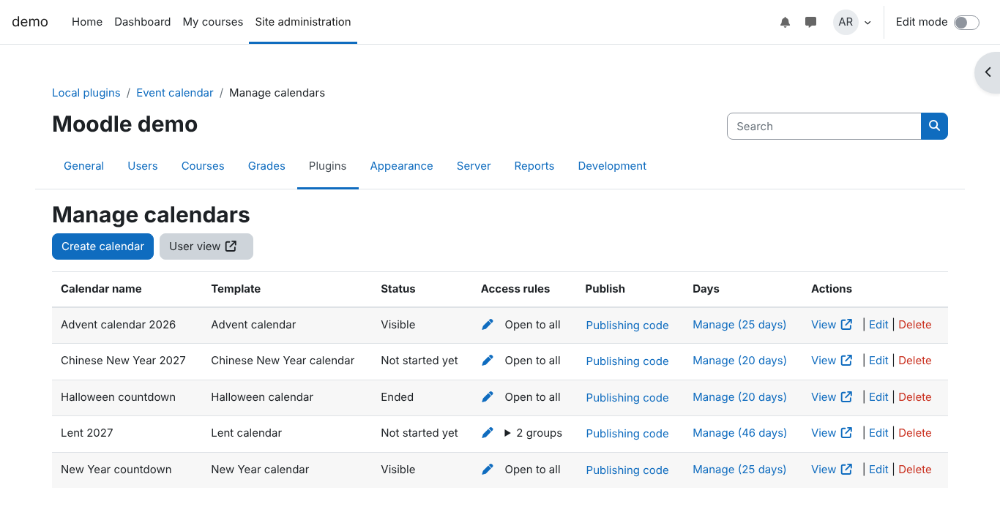
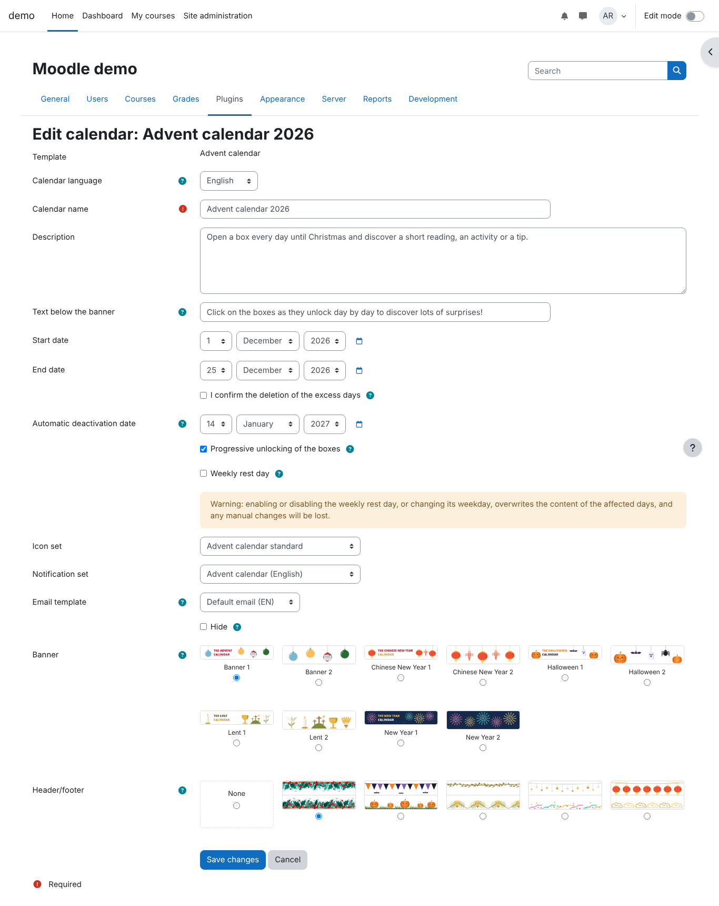
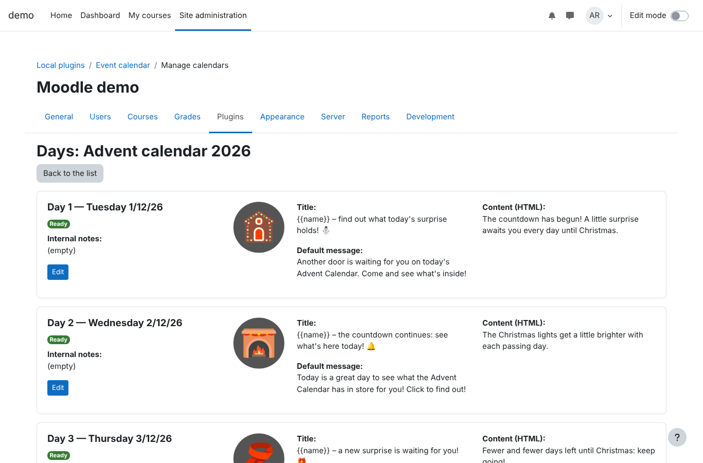
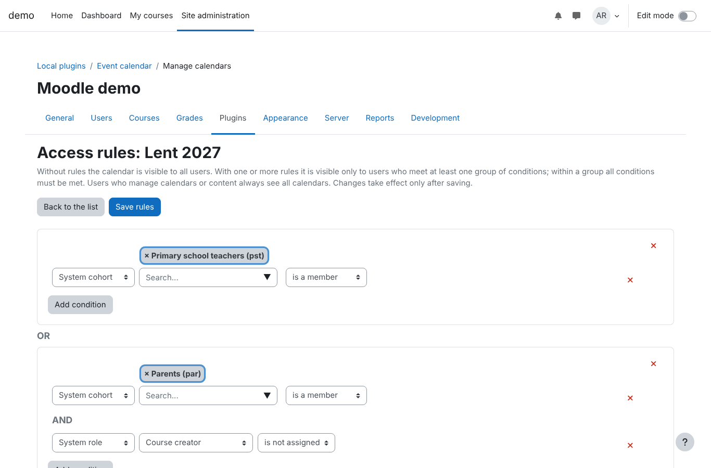
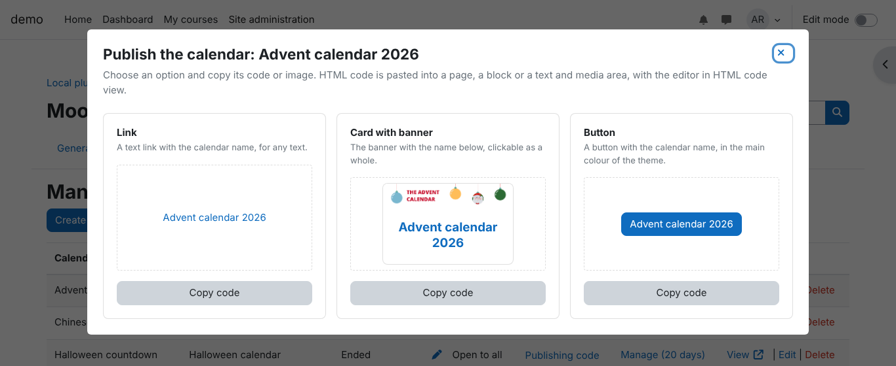
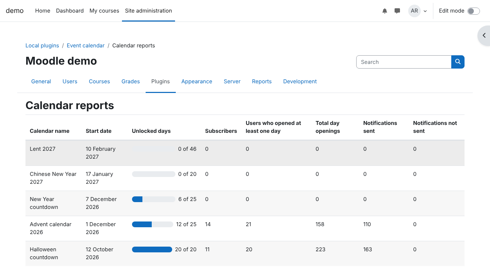
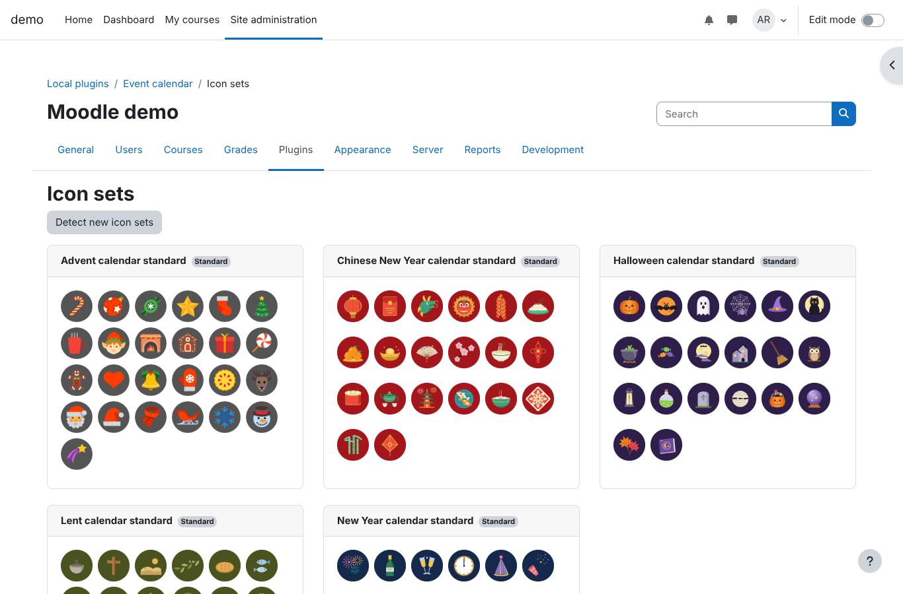

# Event calendar (local_eventcalendar)

Countdown calendars for the whole site (Advent, Lent, New Year, Halloween, Chinese New Year): a grid of boxes that unlock one a day, each with its own content, and optional daily notifications.



## Description

Event calendar adds countdown calendars to a Moodle site. Each calendar is a grid of boxes, one for each day of the countdown. The boxes unlock one a day, and each one opens a page with the content of that day: a short text, a link, an image. Users can subscribe to a calendar and receive the content of the day every morning, by email and Moodle notification.

Calendars are created from a template, which computes the dates of the festivity (fixed, calculated such as Easter, or from a lookup table for lunar festivities) and fills the days with ready-made texts, icons and notifications in English or Italian. Every text can then be changed. A calendar can also be created from scratch, for any period.

The plugin works at site level: calendars do not belong to a course. They can be shown to all users or only to some of them, by system role and system cohort, and they hide themselves after the end date. Ready-made HTML code links them from pages, blocks and text and media areas.

Managers follow the use of the calendars on a report page, with the unlocked days, the day openings, the subscribers and the notifications sent.

Main features:

- templates for Advent, Lent, New Year, Halloween and Chinese New Year, with icon sets, banners and header/footer pairs;
- progressive unlocking of the boxes and an optional weekly rest day;
- daily notifications at 8:00 in the time zone of each user, with an unsubscribe link that works without login;
- email templates, chosen for each calendar;
- access rules by system role and system cohort;
- publishing code (link, card with banner, button) for pages, blocks and text and media areas;
- report of the use of each calendar;
- two system roles, Calendar coordinator and Calendar content curator, to share the work;
- Privacy API, accessibility checks (WCAG 2.1 AA) and PHPUnit and Behat tests.

## Requirements

- Moodle 4.5 to 5.3.
- PHP as required by your Moodle version (minimum 8.1).
- Moodle cron running, for notifications and scheduled tasks.

## Installation

### From the Moodle Plugins directory

Install the plugin from *Site administration > Plugins > Install plugins*, with the zip file or directly from the directory.

### From GitHub

Clone the repository into the `local/eventcalendar` folder of your Moodle installation. The folder name must be `eventcalendar`, not the name of the repository:

```
cd /path/to/moodle
git clone https://github.com/DigitalAdventureMT/moodle-local_eventcalendar.git local/eventcalendar
```

On Moodle 5.1 and later, which keep the code in the `public` folder, clone into `public/local/eventcalendar`.

To install a release, check out its tag, for example `git checkout v2.0.0`.

### After copying the files

1. Complete the upgrade proposed by Moodle, or run `php admin/cli/upgrade.php`.
2. Purge all caches.

The installation creates two system roles, "Calendar coordinator" and "Calendar content curator", and imports the icon sets, email templates and graphic elements distributed with the plugin.

## Screenshots

| | |
|---|---|
|  |  |
| Calendar list | Calendar grid |
|  |  |
| Day page | Calendar management |
|  |  |
| Calendar settings | Days of a calendar |
|  |  |
| Access rules | Publishing code |
|  |  |
| Calendar reports | Icon sets |

## Bug reports and feature requests

Use the [issue tracker](https://github.com/DigitalAdventureMT/moodle-local_eventcalendar/issues) of the GitHub repository.

## Feature details

- **Calendars**: created from a template, with calculated dates (fixed, algorithmic such as Easter, or from a lookup table for lunar festivities), or custom. Manual and date-based visibility, automatic hiding after the end date, progressive unlocking of the boxes, configurable weekly rest day.
- **Days**: HTML content written freely or chosen from the content pack of the template, icon taken from the icon set of the calendar, notification title and body chosen from the notification set, internal notes and progress status. Each day can be previewed, and its email and notification can be sent to yourself for testing.
- **Graphics**: the site logo, a preloaded banner and an optional preloaded header/footer pair for each calendar.
- **Access rules**: for each calendar, groups of conditions combined with OR, with conditions combined with AND inside each group. Available conditions: system role and system cohort. Without rules the calendar is visible to everyone. A scheduled task alerts the managers when a condition refers to an item that no longer exists.
- **Notifications**: users can subscribe to the notifications of a calendar and receive the notification of the day every day at 8:00 in their own time zone (email and Moodle notification). Each calendar chooses its email template, the default one if none is chosen.
- **Publishing**: from the calendar management page, the "Publishing code" button opens a window with ready-made HTML code (link, card with banner, button) and a preview of each option, to paste into pages, blocks and text and media areas.
- **Reports**: the "Calendar reports" page shows, for each calendar, the unlocked days, the total day openings, the users who opened at least one day, the subscribers and the notifications sent and not sent.
- **Notification sets**: created from the standard packs distributed with the plugin, viewable, updatable when a newer version of the pack is available, and deletable.
- **Icon sets, email templates and graphic elements**: the elements distributed with the plugin are listed on dedicated pages and new ones added to the plugin folders are detected with a button. Email templates can be renamed, assigned a language, previewed, set as default and deleted.

## Pages

| Page | Path | Used by |
|---|---|---|
| Calendar list | `/local/eventcalendar/list.php` | all users |
| Calendar grid | `/local/eventcalendar/view.php?id=N` | all users |
| Calendar management | Site administration > Plugins > Local plugins > Event calendar > Manage calendars | coordinators |
| Days of a calendar | `/local/eventcalendar/days.php?calendarid=N` | coordinators and curators |
| Access rules | `/local/eventcalendar/accessrules.php?calendarid=N` | coordinators |
| Notification catalogue, icon sets, email format, graphic elements | Site administration > Plugins > Local plugins > Event calendar | coordinators |
| Calendar reports | Site administration > Plugins > Local plugins > Event calendar > Calendar reports | users with `viewreports` |

The plugin does not add links to the navigation automatically: add the calendars wherever needed on your site (menus, blocks, pages), for example with the publishing code of the management page.

## Capabilities

| Capability | Purpose | Default roles |
|---|---|---|
| `local/eventcalendar:view` | use the plugin | authenticated user, manager |
| `local/eventcalendar:managecalendars` | create, edit and delete calendars; access rules; sets and templates | manager, Calendar coordinator |
| `local/eventcalendar:managecontent` | manage the content of the days | manager, Calendar content curator |
| `local/eventcalendar:viewreports` | calendar reports page | manager, both plugin roles |

## Scheduled tasks

| Task | Default schedule |
|---|---|
| Send day notifications | every 10 minutes |
| Hide expired calendars | every hour |
| Check for access rules that are no longer valid | Tuesday and Thursday at 7:23 |

## Email delivery

The notifications are sent by the "Send day notifications" task. Each run sends at most the number of notifications set in *Site administration > Plugins > Local plugins > Event calendar > Settings* (default 500, 0 for no limit); the remaining ones are sent by the next runs, until the end of the day of each user. Spreading the emails over time helps prevent the sending domain from being flagged as a spam source. Users whose email address Moodle would refuse (invalid, or too many bounces when bounce handling is enabled) are skipped, and the case is written in the task log. A failed sending is retried once, by the next run; both failures are written in the task log.

Every notification email has an unsubscribe link, which works without login, and the List-Unsubscribe headers for the one-click unsubscribe of email clients. The default email template shows the link with the `{{unsubscribeurl}}` placeholder.

Email providers also check the authentication of the sending domain. Before sending notifications to many users, make sure that the domain of the sender address (*noreply address* setting of Moodle) has:

- an SPF record that authorises the mail server used by Moodle;
- a DKIM signature, set up on the mail server or SMTP service;
- a DMARC policy aligned with SPF and DKIM.

Large providers such as Gmail and Yahoo require all three for senders of many messages. These records are set in the DNS of the domain and in the mail server, not in Moodle.

## Adding graphic elements and templates

The elements distributed with the plugin are read from its folders:

- icon sets: `pix/iconsets/<name>/`, with an `iconset.json` file;
- banners: `pix/banners/`, listed in `banners.json`;
- header/footer pairs: `pix/headerfooters/`, listed in `headerfooters.json`;
- email templates: `email_templates/<language>/`, an HTML file with a `.json` metadata file;
- content and notification packs: `content_packs/<language>/<template>.json`.

New elements are imported at the next installation or upgrade of the plugin, or with the detection buttons of the management pages.

## Subplugins

The plugin declares two subplugin types, `ecaddon` (`local/eventcalendar/addon`) and `ecpack` (`local/eventcalendar/pack`). Subplugins extend the plugin through the Moodle Hooks API; the hooks are in `classes/hook`.

## Privacy

The plugin stores the days opened by each user, notification subscriptions and sent notifications, as well as the author of configuration items. It implements the Moodle Privacy API: data can be exported and deleted with the site privacy tools. On deletion requests, configuration items are anonymised instead of deleted.

## Languages

English strings are in `lang/en`. The Italian translation is in `lang/it`; once the plugin is published in the Moodle Plugins directory, translations are managed through AMOS.

## Tests

PHPUnit and Behat tests are in `tests/` and run with the standard Moodle procedure:

```
vendor/bin/phpunit --testsuite local_eventcalendar_testsuite
vendor/bin/behat --config <behat dataroot>/behatrun/behat/behat.yml --tags=@local_eventcalendar
```

The Behat features check the publishing window, the reports page and the plugin pages against the Moodle accessibility standards (axe, WCAG 2.1 AA).

## Accessibility

The plugin pages follow the Moodle accessibility guidelines: every field has a label, icon-only controls have a text alternative, information conveyed by colour is also available as text, the preview window is a keyboard-accessible modal dialog and dynamic changes are announced to screen readers.

## License

GNU GPL v3 or later. Copyright 2026 Marco Tosatto <marco.tosatto@digitaladventure.it>.
